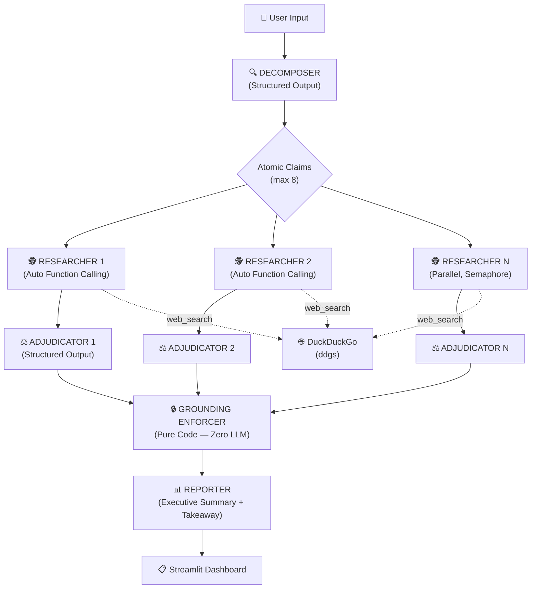
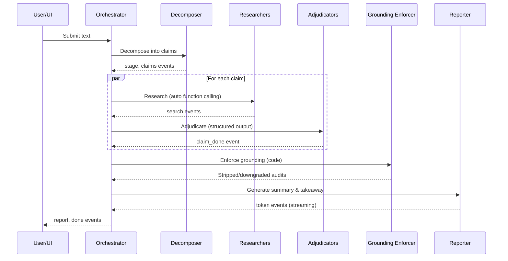

# 🛡️ FactShield AI — Autonomous Multi-Agent Fact-Checking Engine

[](https://python.org)
[](https://streamlit.io)
[](https://ai.google.dev)

An autonomous multi-agent system that decomposes text into atomic claims, adversarially researches each claim on the live web, enforces citation grounding in code, and streams an audit report through a Streamlit UI.

## Architecture



## Event Sequence



## Quick Start

### 1. Clone & Set Up

```bash
git clone <repo-url>
cd "FactShield AI"
python -m venv .venv

# Activate venv
# Windows:
.venv\Scripts\activate
# Linux/macOS:
source .venv/bin/activate

pip install -r requirements.txt
```

### 2. Configure

```bash
cp .env.example .env
# Edit .env and add your Gemini API key:
# GEMINI_API_KEY=your_actual_key_here
```

### 3. Run

```bash
streamlit run app/ui.py --server.port 8501
```

Then open [http://localhost:8501](http://localhost:8501) in your browser.

### CLI Mode

```bash
python -m src.agent_workflow "The Great Wall of China is visible from space."
```

## How the Grounding Enforcer Works

The Grounding Enforcer is a **pure code** step (zero LLM) that runs after adjudication:

1. **URL Stripping**: Removes any URL from `primary_sources`, `contradictions`, `finding_summary`, and `analysis` that was NOT returned by a `web_search` call (tracked via `EvidenceLedger`).
2. **Verdict Downgrading**:
   - No searches → `UNVERIFIED`, confidence ≤ 30
   - `VERIFIED` requires ≥2 grounded sources across ≥2 distinct domains; otherwise → `UNVERIFIED`, confidence ≤ 50
   - `FALSE`/`MISLEADING` require ≥1 grounded source; otherwise → `UNVERIFIED`
3. **Auditor Notes**: Every automated action is logged in the analysis field as an "Auditor note".

This ensures that **no hallucinated URL ever reaches the user**, and verdicts are only as strong as their evidence.

## Project Structure

```
FactShield AI/
├── app/
│   └── ui.py                  # Streamlit dashboard
├── src/
│   ├── __init__.py
│   ├── schemas.py             # Pydantic v2 domain types
│   ├── agent_workflow.py      # Multi-agent pipeline
│   └── tools/
│       ├── __init__.py
│       └── search_tool.py     # DuckDuckGo search wrapper
├── tests/
│   ├── conftest.py            # Fixtures & fake clients
│   ├── test_schemas.py        # Schema validation tests
│   ├── test_search_tool.py    # Search tool tests
│   ├── test_grounding.py      # Grounding enforcer tests
│   ├── test_workflow.py       # Pipeline event tests
│   ├── test_ui.py             # Streamlit AppTest tests
│   └── test_live.py           # Live API tests (@pytest.mark.live)
├── logs/                      # Runtime logs
├── requirements.txt           # Production dependencies
├── requirements-dev.txt       # Dev/test dependencies
├── .env.example               # Environment template
├── .gitignore
└── README.md
```

## Configuration

| Variable | Default | Description |
|----------|---------|-------------|
| `GEMINI_API_KEY` | _(required)_ | Your Google AI API key |
| `GEMINI_MODEL` | `gemini-3.6-flash` | Model to use |
| `MAX_CLAIMS` | `8` | Max atomic claims to extract |
| `MAX_PARALLEL` | `2` | Concurrent researcher agents |
| `SEARCH_BUDGET_PER_CLAIM` | `6` | Max web searches per claim |

## Testing

```bash
# Install dev dependencies
pip install -r requirements-dev.txt

# Run offline tests
pytest -q

# Run live tests (requires GEMINI_API_KEY)
pytest tests/test_live.py -m live -v
```

## Limitations

- **Snippet-only evidence**: The engine works from search result snippets, not full web pages. This limits depth of analysis.
- **Search engine dependency**: Results depend on DuckDuckGo availability and result quality.
- **Model limitations**: Verdicts reflect the model's judgment on evidence; confidence should rarely exceed 95%.
- **Rate limiting**: Concurrent searches are paced to avoid DuckDuckGo rate limits.
- **Language**: Core verdict keywords are always in English; prose follows the input language.

## Responsible Usage

> **This tool is designed to assist, not replace, human judgment.**
>
> - Always independently verify claims marked as VERIFIED before citing them in critical contexts.
> - The engine provides a structured research starting point, not a definitive truth oracle.
> - Do not use this tool to generate misleading content or to justify pre-existing biases.
> - Search results and AI judgments can be wrong. Cross-reference important findings.

## Troubleshooting

| Problem | Solution |
|---------|----------|
| `ModelUnavailableError` | Check `GEMINI_MODEL` in `.env`. Run with default `gemini-3.6-flash`. |
| `No GEMINI_API_KEY set` | Add your key to `.env` file. See `.env.example`. |
| Search returning 0 results | Check internet connectivity. DuckDuckGo may be rate-limiting. |
| Import errors | Ensure you're using the project's `.venv`. Run `pip install -r requirements.txt`. |
| Port 8501 in use | Kill existing Streamlit process or use `--server.port 8502`. |

## License

MIT
